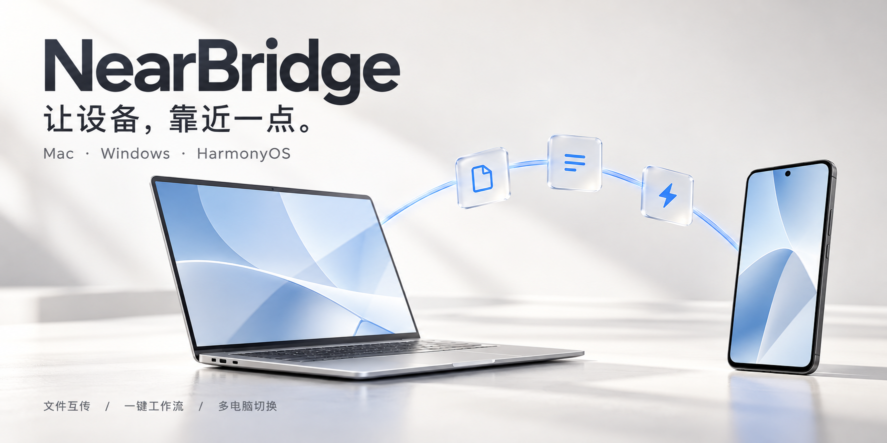
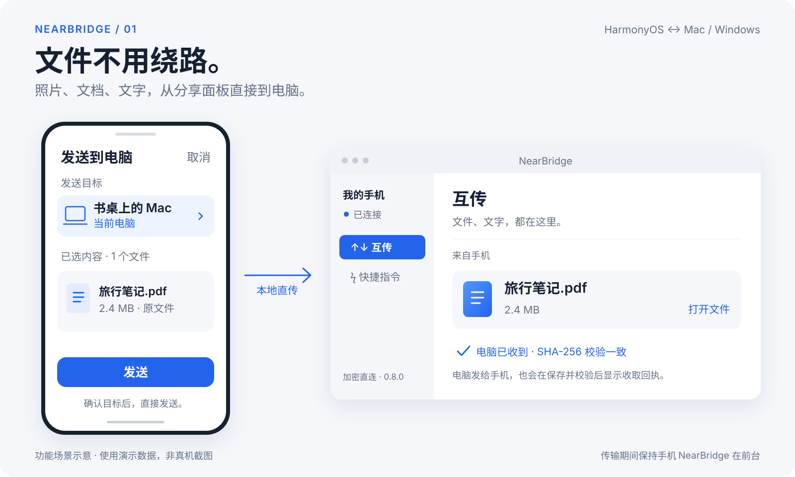
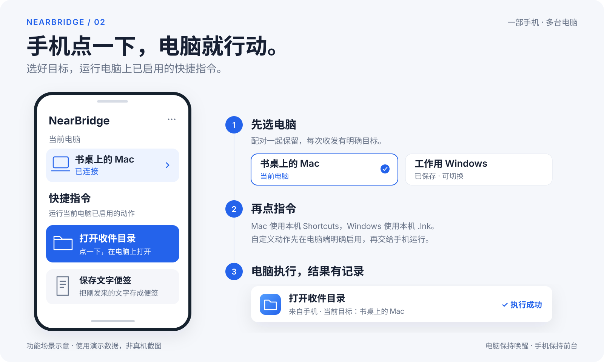
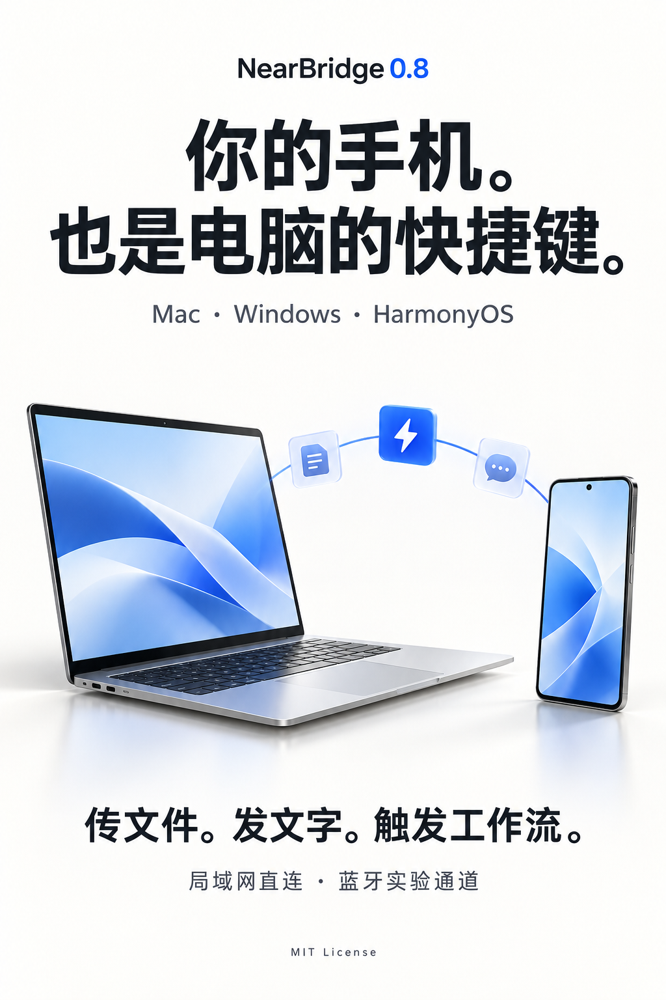

# NearBridge



**把文件直接传过去，把电脑常用动作放进手机。**

NearBridge 是 Mac、Windows 与 HarmonyOS 之间的本地互联工具。通过系统分享、窗口拖放和手机快捷指令，让照片、文件、文字与常用动作在自己的设备之间流动。日常使用原生客户端，传输不经过云端中转。

**0.8.0** · macOS / Windows / HarmonyOS 6 · 局域网 HTTPS · 实验性 BLE · [MIT](LICENSE)

[演示](#看看怎么用) · [开始使用](#开始使用) · [能力与边界](#能力与验证范围) · [架构](docs/ARCHITECTURE.md) · [贡献](CONTRIBUTING.md) · [更新记录](CHANGELOG.md)

## 让日常操作少绕一步

| 你想做的事 | NearBridge 的做法 |
| --- | --- |
| 把手机上的照片、文件交给电脑 | 在系统分享面板选择 **发送到电脑**，确认目标后发送 |
| 把电脑上的资料带到手机 | 拖进窗口、通过 Finder 服务或 Windows“发送到”加入队列；手机保存并校验后返回收取回执 |
| 把文字或链接换个设备继续用 | 在应用内发送文字，接收后复制或打开链接 |
| 用手机执行电脑上的常用动作 | 一键打开收件目录、保存文字便签，或运行电脑端明确启用的快捷指令 |
| Mac、Windows 都在用 | 手机“我的电脑”保留多台配对，选定当前目标；每台电脑的凭据、队列、记录与蓝牙设置分别保存 |

## 看看怎么用

下面两张图是使用演示数据制作的**功能场景示意**，不是实际设备截图；顶部横幅与文末海报为概念宣传图。

### 分享一下，就到电脑

手机从图库或文件管理器分享给 NearBridge；电脑端收到后可以直接打开文件或所在目录。反向发送时，“手机已收取”表示手机已保存文件并完成 SHA-256 校验。



### 手机点一下，电脑就行动

先选当前电脑，再点已启用的快捷指令。Mac 对接本机 Shortcuts，Windows 对接本机明确加入的 `.lnk` 快捷方式；手机不能提交任意命令。Windows 的执行回执表示已请求启动快捷方式，不代表目标程序的业务操作已经完成。



## 开始使用

目前按下列步骤从源码构建。HarmonyOS 真机安装需要官方 SDK、自己的华为开发者账号和设备签名；仓库不包含个人签名材料。

| 平台 | 构建要求 | 客户端 |
| --- | --- | --- |
| Mac | macOS 13+、Node.js 22.13+、Xcode Command Line Tools、OpenSSL | SwiftUI 窗口、菜单栏、Finder 服务 |
| Windows | Windows 10 2004+ / Windows 11、Node.js 22.13+、Git for Windows、.NET 10 SDK、Edge WebView2 Runtime | 托盘、WebView2 工作台、资源管理器“发送到” |
| 手机 | HarmonyOS 6 / API 20+；Mac 或 Windows 上的官方 DevEco Studio | ArkUI 原生应用、系统分享入口 |

先取得源码并安装依赖：

```sh
git clone https://github.com/ZJUZhiyuCai/NearBridge.git
cd NearBridge
npm ci --ignore-scripts
```

### Mac

```sh
npm run build:mac
npm run install:mac
```

安装到 `~/Applications/NearBridge.app`，随后打开 NearBridge。更新前先从菜单栏退出 NearBridge；安装器保留应用目录身份和用户数据。使用 `⌃⌥空格` 唤出窗口，关闭窗口后继续驻留菜单栏。

### Windows

```powershell
npm run build:windows
npm run install:windows
npm run start:windows
```

构建产物为 `dist/windows/NearBridge.exe`，包含 Node 与 .NET 运行时。安装器写入 `%LOCALAPPDATA%\Programs\NearBridge` 并添加开始菜单、资源管理器“发送到”入口；更新前先退出托盘程序。使用 `Ctrl+Alt+空格` 唤出窗口。

Windows 产物目前没有商业代码签名；Git for Windows 中的 OpenSSL 用于生成本地证书。工具路径覆盖与完整要求见 [Windows 使用与构建](windows/README.md)。

### HarmonyOS

在官方 DevEco Studio 中打开 `harmony` 工程，完成自己的账号登录、设备调试授权与签名配置，再在仓库根目录运行：

```sh
npm run build:phone
```

脚本兼容 Mac 和 Windows 的 DevEco 安装；自定义位置可设置 `NEARBRIDGE_DEVECO_APP`。真机安装使用 `harmony/entry/build/default/outputs/default/entry-default-signed.hap`。详见 [鸿蒙工程与签名](harmony/README.md)。调试连接只用于开发安装，日常互传不需要一直开启无线调试。

### 第一次连接

1. 让手机和目标电脑加入同一局域网，在电脑 NearBridge 打开原生配对码。多个网卡时选择手机可达的地址。
2. 手机进入 **我的电脑 → 添加电脑**，扫码后在目标电脑批准。
3. 确认手机显示正确的当前电脑，开始收发文件或使用快捷指令。要添加第二台电脑，重复前两步；原配对继续保留。

日常传输时，**电脑保持唤醒，手机 NearBridge 保持前台**。收到的手机文件先保存在应用内，可通过“另存为”导出。电脑可以先将文件加入待发队列，手机上线后收取；“加入队列”与“手机已收取”是两个不同状态。

## 连接怎么选

| 模式 | 行为 | 适合的场景 |
| --- | --- | --- |
| **自动** | 优先局域网；不可达时尝试这台电脑已选的蓝牙设备。传输期间保持线路 | 日常使用 |
| **仅局域网** | 通过本地 HTTPS 传输 | 照片合集、视频和较大文件 |
| **仅蓝牙** | 通过 BLE 转发现有 TLS 通道，不回退局域网 | 文字、工作流和小文件；实验功能 |

使用蓝牙前，先在电脑打开“允许手机用蓝牙连接”，再在手机当前电脑的“连接与设置”中选择对应设备。Windows 蓝牙适配器与驱动需要支持 BLE peripheral role。建议先运行“检查蓝牙连接”，它会往返校验一份 32 KB 文件。

蓝牙的吞吐量和长时间稳定性仍待验证，不建议拿它传照片合集或视频。若操作显示“结果未确认”，切回对应电脑点“重试确认”继续原操作；先检查结果，再决定是否“结束重试”。结束重试不会撤销已经执行的动作。

## 能力与验证范围

| 能力 | 当前状态 |
| --- | --- |
| 双向文件、文字、系统分享、文件夹 ZIP | 已实现；文件上传支持断点续传，收件有 SHA-256 校验 |
| 多电脑保存与切换 | 最多 8 台；一次与当前电脑收发，系统分享页明确显示目标 |
| 工作流与文字可靠重试 | 两端持久化操作编号，七天内复用回执，避免丢响应后重复执行 |
| 增量同步、变更通知、自动选路 | 已实现；使用同一套电脑与手机协议 |
| BLE 小文件与工作流 | Mac / Windows 均有真机验证记录；仍为实验功能 |
| 锁屏手机后台常驻、投屏、通知镜像、Wi-Fi Direct / AWDL | 尚未实现 |

**最近一次 Mac 真机验证：2026-10-27。** Mac 已安装 0.8.0，原 13 条收发记录保留；Mac → 手机的 32 KB 文件收到校验回执，手机触发“打开收件目录”有成功记录，纯蓝牙双向自检通过且 Mac 落盘文件大小、SHA-256 一致。用户确认手机同时保留 Windows 与 Mac 两台电脑。

这覆盖了本次升级的基本互联路径，多电脑轮流操作的完整故障矩阵、大文件吞吐量和长时间蓝牙压力测试仍待完成。证据与版本范围见 [0.8 验证记录](docs/UNIFIED-0.8.md)、[Windows 验证记录](docs/WINDOWS-VERIFICATION.md)、[历史 Mac 记录](docs/VERIFICATION.md)及[测试矩阵](docs/TESTING.md)。

## 本地数据与安全

扫码配对采用私有 CA、公钥固定与电脑端显式批准。二维码五分钟、单次有效；手机会话三十天，可在电脑撤销。服务依赖本机账户和目录权限，不提供应用层磁盘加密。

| 内容 | Mac | Windows |
| --- | --- | --- |
| 收件文件 | `~/Downloads/NearBridge` | `%USERPROFILE%\Downloads\NearBridge` |
| 配对、证书、历史与发件副本 | `~/Library/Application Support/NearBridge` | `%LOCALAPPDATA%\NearBridge` |

- 管理服务只监听 `127.0.0.1:53318`；原生手机服务使用 HTTPS `53320`，备用网页使用 HTTPS `53319`，mDNS 使用 UDP `5353`。
- 防火墙如有提示，由机主允许可信专用网络上的应用 `node.exe`，无需开放回环管理端口。
- 单文件上限 512 MiB，服务暂存配额 2 GiB；记录最多 1000 条，状态窗口最多 200 条且至多 8 MiB JSON。局域网文件分块至多 4 MiB，BLE 为 64 KiB。
- 配对凭据、签名材料、私人日志和真实收发文件不进入仓库。

协议细节见 [PROTOCOL](docs/PROTOCOL.md)，漏洞报告与安全边界见 [SECURITY](SECURITY.md)。

## 开发与贡献

```sh
npm start                  # 仅开发服务；不要与客户端服务重复启动
npm run check              # 语法、版本、仓库文件和文档链接
npm test                   # 服务、手机业务、桌面状态与系统适配
npm run build:mac          # Swift 构建与签名验证
npm run build:windows      # 构建后 npm test 包含 Windows 原生回归
npm run benchmark          # 隔离的本机变更通知基准
npm run benchmark:active   # 完整快照与增量响应对照
```

CI 覆盖 Windows .NET 构建与原生测试、Linux Node 22/24/26，以及 macOS Swift 构建和签名检查。鸿蒙 SDK 编译、签名与真机验收独立进行。性能基准的范围和结果见 [PERFORMANCE](docs/PERFORMANCE.md)，不能直接当作手机端到端延迟。

[架构与模块职责](docs/ARCHITECTURE.md) · [贡献指南](CONTRIBUTING.md) · [开发路线](docs/ROADMAP.md) · [问题反馈](https://github.com/ZJUZhiyuCai/NearBridge/issues)

## 宣传素材

[查看 / 下载竖版海报](docs/media/nearbridge-poster-0.8.png) · [全部素材与来源说明](docs/media/README.md)

<a href="docs/media/nearbridge-poster-0.8.png"></a>

源码与仓库内自制宣传素材采用 [MIT](LICENSE)。第三方依赖、Microsoft WebView2 与华为 SDK 按各自许可使用；平台名称仅用于说明兼容性。
