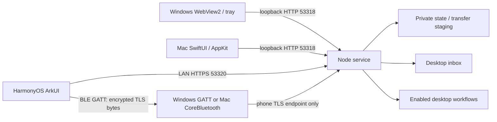

# Architecture

## Windows and Mac desktops (0.8)

Windows and Mac are both supported. windows/BridgeWindow.cs hosts the shared local UI in WebView2 and supplies the tray, hotkey, pickers and per-user Send To IPC. Its normal controls live in the web workspace; the native toolbar remains a load-failure fallback. windows/BridgeClient.cs owns durable action/upload journals; windows/BluetoothBridge.cs provides Windows GATT alongside the existing Mac CoreBluetooth relay. Both transports reach the same Node service and phone TLS endpoint.

The mac role/source and /api/mac/* paths remain compatibility identifiers for either desktop. Windows uses fixed PowerShell source with JSON stdin, LocalAppData and locally resolved .lnk workflow IDs. src/discovery.mjs publishes _nearbridge._tcp on Windows; the Mac host retains its publisher. POSIX modes are not Windows ACL guarantees. The following original architecture and protocol flows also apply to Windows with these platform adapters.

The HarmonyOS client can retain up to eight computers and select one active target. Each desktop runs its own local service. All user data stays on the paired devices; no relay service is involved.

The web fallback uses HTTPS 53319. Only the Mac admin interface can approve pairing, enable workflows, read the clipboard, or open local files/links. The BLE relay cannot reach admin endpoints.

## Modules

| Location | Responsibility |
| --- | --- |
| `src/server.mjs` | HTTP routing, authentication, pairing, bounded observers, state revision and delivery |
| `src/state-feed.mjs` | Credential-scoped revision manifests, bounded history, optional item deltas and snapshot fallback |
| `src/store.mjs`, `src/transfers.mjs` | Index, filenames, quotas, persistent upload offsets, SHA-256 and receipts |
| `src/actions.mjs` | Bounded, expiring operation receipts committed with text/jobs |
| `src/workflows.mjs`, `src/system.mjs` | Enabled workflow IDs, idempotent jobs, argument-array OS calls |
| `src/certificate.mjs` | Private CA, pinned server key, local address certificate renewal |
| `macos/BridgeModel.swift`, `Models.swift` | Mac change subscription, queue, durable action journal, native API models |
| `macos/BluetoothBridge.swift`, `BluetoothProtocol.swift` | Bounded BLE framing, backpressure, forwarding TLS bytes |
| `harmony/entry/src/main/ets/core/BridgeClient.ets` | Pinned HTTPS, change subscription, lifecycle, automatic route selection, durable action journal, file storage/receipts |
| `harmony/entry/src/main/ets/core/BluetoothTunnel.ets` | BLE central and bounded loopback TLS tunnel |
| `scripts/` | Builds, toolchain discovery, repository checks, isolated benchmark |

## State delivery

A process-random epoch plus increasing sequence forms the state revision. `/api/state` starts a client session; `/api/changes?since=...` returns immediately for an outdated revision or waits at most 25 seconds for a change. Idle replies omit history. Each delayed delivery rechecks the original credential, even if the device ID was retained during re-pairing.

Native clients reject lower revisions from the same server epoch. Phone file receive work is separate from its notification loop, so a long download does not delay workflow-state updates. Going to the background destroys pending HTTP tasks and invalidates old callbacks. Network retries back off to 15 seconds. Invalid sessions stop automatic polling until re-pairing.

Old clients can continue polling `/api/state`; new clients detect servers without revisions and retain the earlier polling fallback. The existing web client continues using bounded SSE notifications.

Version 0.5 clients opt into `mode=delta-v1`. A changed response contains either a full snapshot or a delta against the exact requested revision. Deltas carry changed items, removed IDs, optional ordering and current metadata. Each role retains at most 32 ID/hash manifests; a credential change discards that role's old baselines. Older text bodies are not copied into the baseline cache. Unknown, evicted or more expensive deltas fall back to snapshots. Both clients validate merges before replacing visible state and bootstrap again on a mismatch.

History snapshots contain at most 200 items and 8 MiB of encoded item JSON, whichever comes first. This bounds even heavily escaped valid text below the phone's 20 MiB response limit. Individual texts remain intact; all stored items still count toward the 1000-item quota.

## File lifecycle

1. Reserve a UUID, name and size; reserved bytes count against quota.
2. Commit each expected-offset chunk. Asynchronously write and fsync file data, recheck authorization, then persist and publish the offset. A slow fsync yields to other HTTP requests; zero-progress writes and failed metadata commits never advance the offset.
3. Hash the completed upload, then add it to the Mac inbox/outbox. Repeating completion returns the same item.
4. Phone downloads use byte ranges and private `.part` files. Verify the complete SHA-256 before renaming and recording the file.
5. Phone acknowledges the verified hash. If only this acknowledgement fails, keep the local file and retry the receipt without downloading again.

Duplicate receipts return success without another index write or notification. Revocation/credential rotation aborts active downloads; expiry is checked by the one-second presence timer. Bytes already delivered or queued by the network cannot be recalled.

These operations support process-interruption recovery; full sudden-power-loss durability across every filesystem metadata write has not been verified. Files and text have no application-level at-rest encryption.

## Scope

Each desktop still pairs with one phone; the phone stores multiple computers and uses one at a time. Foreground phone operation. Automatic selection or explicit LAN-only/BLE-only mode is stored per computer. Computers remain awake. There is no cloud, Internet relay, Wi-Fi Direct/AWDL implementation, hidden background keepalive, or notification mirroring.

The phone's atomic `computers.json` registry stores an active profile ID and non-session identity metadata. Each new computer has its own `computers/<UUID>/` directory for CA, session, Bluetooth settings, action journal, send queue and received files. The original pairing is registered in place as a legacy profile so saved paths and operation IDs survive migration. Switching cancels old requests, resets state/delta baselines, and loads only the selected profile. Busy transfers/actions reject switching. A corrupt registry fails closed rather than silently overwriting it or resurrecting a forgotten legacy pairing. Forgetting removes the selectable identity but retains downloaded files/journals; it does not undo remote actions or revoke the desktop session.

State snapshots and native QR payloads include optional `platform` metadata (`windows`, `macos`, `unknown`). Old desktops/clients remain compatible; labels fall back to “电脑”. Platform names never select authentication rules or replace certificate pinning.

See [protocol](PROTOCOL.md), [testing](TESTING.md), [security](../SECURITY.md), and [implementation notes](DESIGN.md).
