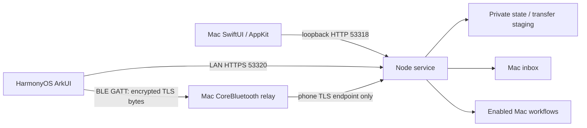

# Architecture

NearBridge has two native clients and one local service. All user data stays on the paired devices; no relay service is involved.

The web fallback uses HTTPS 53319. Only the Mac admin interface can approve pairing, enable workflows, read the clipboard, or open local files/links. The BLE relay cannot reach admin endpoints.

## Modules

| Location | Responsibility |
| --- | --- |
| `src/server.mjs` | HTTP routing, authentication, pairing, bounded observers, state revision and delivery |
| `src/store.mjs`, `src/transfers.mjs` | Index, filenames, quotas, persistent upload offsets, SHA-256 and receipts |
| `src/workflows.mjs`, `src/system.mjs` | Enabled workflow IDs, idempotent jobs, argument-array OS calls |
| `src/certificate.mjs` | Private CA, pinned server key, local address certificate renewal |
| `macos/BridgeModel.swift`, `Models.swift` | Mac change subscription, queue, native API models |
| `macos/BluetoothBridge.swift`, `BluetoothProtocol.swift` | Bounded BLE framing, backpressure, forwarding TLS bytes |
| `harmony/entry/src/main/ets/core/BridgeClient.ets` | Pinned HTTPS, change subscription, lifecycle, file storage/receipts |
| `harmony/entry/src/main/ets/core/BluetoothTunnel.ets` | BLE central and bounded loopback TLS tunnel |
| `scripts/` | Builds, toolchain discovery, repository checks, isolated benchmark |

## State delivery

A process-random epoch plus increasing sequence forms the state revision. `/api/state` starts a client session; `/api/changes?since=...` returns immediately for an outdated revision or waits at most 25 seconds for a change. Idle replies omit history. Each delayed delivery rechecks the original credential, even if the device ID was retained during re-pairing.

Native clients reject lower revisions from the same server epoch. Phone file receive work is separate from its notification loop, so a long download does not delay workflow-state updates. Going to the background destroys pending HTTP tasks and invalidates old callbacks. Network retries back off to 15 seconds. Invalid sessions stop automatic polling until re-pairing.

Old clients can continue polling `/api/state`; new clients detect servers without revisions and retain the earlier polling fallback. The existing web client continues using bounded SSE notifications.

## File lifecycle

1. Reserve a UUID, name and size; reserved bytes count against quota.
2. Commit each expected-offset chunk. Write and fsync file data before advancing the persisted offset.
3. Hash the completed upload, then add it to the Mac inbox/outbox. Repeating completion returns the same item.
4. Phone downloads use byte ranges and private `.part` files. Verify the complete SHA-256 before renaming and recording the file.
5. Phone acknowledges the verified hash. If only this acknowledgement fails, keep the local file and retry the receipt without downloading again.

These operations support process-interruption recovery; full sudden-power-loss durability across every filesystem metadata write has not been verified. Files and text have no application-level at-rest encryption.

## Scope

One Mac and one paired phone. Foreground phone operation. Explicit LAN/BLE selection. Mac remains awake. There is no cloud, Internet relay, Wi-Fi Direct/AWDL implementation, hidden background keepalive, or notification mirroring.

See [protocol](PROTOCOL.md), [testing](TESTING.md), [security](../SECURITY.md), and [implementation notes](DESIGN.md).
